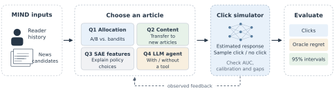

# Bandits vs. A/B Testing for News Recommendation

CSE 592 project by Mansi Sethi, Samee Arif, and Andrew Koss, University of Michigan.

We compare fixed A/B allocation, conventional and contextual bandits, sparse-autoencoder feature policies, and LLM agents in a MIND-based click simulator. Policy results are semi-synthetic: the learned model estimates click probabilities, and those estimates define the simulation oracle.



## Midway report

- [Compiled report](latex/paper.pdf)
- [LaTeX source](latex/paper.tex) and [bibliography](latex/paper.bib)
- [Build instructions and experiment provenance](latex/README.md)

The report includes simulator validation, representative policy comparisons, a completed probability-gap sensitivity experiment, and a separate unnumbered plan for the final submission. Feature-label validation and the interactive demonstration remain planned work.

## Repository versions

- `main`: current implementation, promoted from the latest `final` snapshot, plus the midway report.
- `final`: preserved November 1 implementation and experiment snapshot (`f649242`).
- `experiments/mind-bandits-sae-control`: earlier implementation and SAE-control experiments.
- `archive/pre-final-main-2026-11-07`: the previous `main`, including the initial data exploration (`0b2e2b8`).

All versions retain their history. No force-push or branch deletion is needed to move between them.

## Code and results

- `src/data` and `src/simulator`: MIND processing, article and history features, click models, and the shared probability interface.
- `src/bandits`: conventional and contextual policies and their evaluation environments.
- `src/agents`: LLM decisions with an optional posterior-statistics tool.
- `scripts` and `slurm`: preprocessing, training, experiment execution, and analysis.
- `results/q1` through `results/q4`: saved outputs and question-specific summaries.
- `latex/evidence`: inputs and checks for the midway report's additional sensitivity experiment.

The top-level `results.md` records an older experiment setup. Use the question-specific summaries for the current reported runs. The code calls the November 15, 2019 labeled MIND development split `test`; it is not the hidden-label official benchmark test set.

## Reproduce

Large arrays and model files are stored with Git LFS. Install Git LFS and retrieve the stored artifacts when reproducing saved experiments:

```sh
git lfs install
git lfs pull
python -m venv .venv
source .venv/bin/activate
pip install -r requirements.txt
```

Run experiment modules from the repository root. GPU feature extraction and LLM evaluation use the separate environments described by the Slurm scripts. To compile the report with Tectonic:

```sh
tectonic --keep-logs --keep-intermediates latex/paper.tex
```

The completed midway sensitivity experiment can be rerun with:

```sh
.venv/bin/python latex/scripts/gap_sensitivity.py
```
