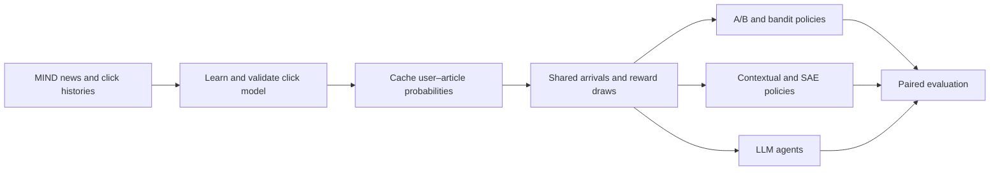
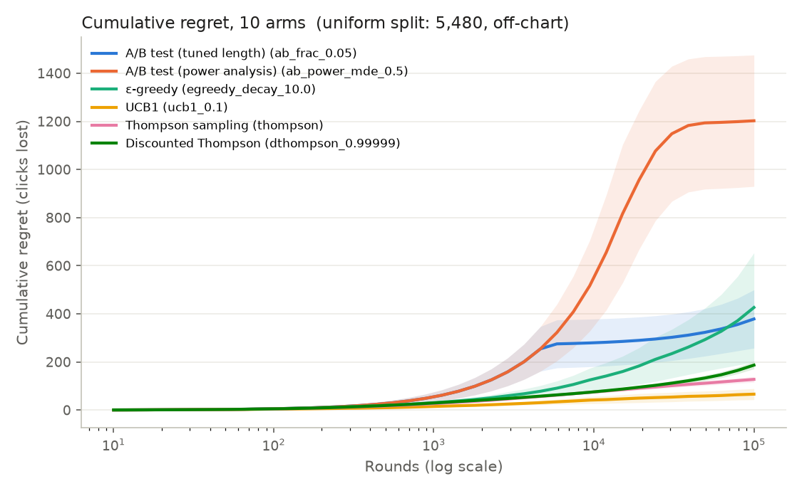
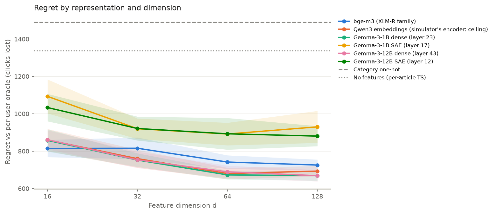

# Bandits vs. A/B Testing for News Recommendation

**Mansi Sethi · Samee Arif · Andrew Koss**

University of Michigan · CSE 592

When should a news recommender stop exploring, and what information helps it learn faster? We compare fixed A/B allocation, conventional bandits, contextual policies, sparse autoencoder (SAE) features, and LLM agents using a click simulator learned from MIND-large.

**All policy results are semi-synthetic.** Real news, reading histories, and logged clicks train and validate the simulator. Its estimated probabilities then generate bandit rewards and define the evaluation oracle. These experiments measure behavior within that simulator; they are not an online deployment or a counterfactual evaluation of MSN traffic.

[Results](#results) · [Setup](#setup) · [Reproduce saved analyses](#reproduce-saved-analyses) · [Full experiment pipeline](#full-experiment-pipeline) · [Repository layout](#repository-layout) · [Limitations](#limitations)

## Research questions

| Question | Comparison | Main measurements |
|---|---|---|
| **Q1: Allocation** | Explore-then-commit A/B, ε-greedy, UCB, Thompson sampling (TS), discounted TS | Cumulative regret, expected CTR, best-arm selection; stationary and drifting rewards |
| **Q2: Transfer to new articles** | No features, categories, BGE-M3, dense Gemma representations, SAE features | Personalized regret, cold-start regret, dimension and article-lifetime sensitivity |
| **Q3: Policy interpretation** | Train-ranked SAE features, post-hoc removal, retraining with features removed, random controls | Decision changes, regret changes, importance stability, label coverage |
| **Q4: LLM decisions** | Gemma-3-12B-IT with and without a posterior-statistics tool, headline-only prior, bandit baselines | Regret, exploration failures, tool use, token consumption |



## Results

The tables below summarize the saved experiment snapshot. Values after **±** are 95% t-interval half-widths over **30 evaluation runs**. Regret is measured in expected clicks lost; lower is better. Comparisons between policies use paired runs. The oracle and horizon differ across questions, so regret values should be compared **within** an experiment.

### Simulator validation

Model selection fits November 9–13, 2019 and validates on November 14. The selected two-epoch MLP is refit on November 9–14 and evaluated on November 15. Article title and abstract embeddings come from [Qwen3-Embedding-0.6B](https://huggingface.co/Qwen/Qwen3-Embedding-0.6B); user features summarize previously clicked articles.

| Quantity | Value |
|---|---:|
| Article catalog, union of the two labeled splits | 104,151 |
| Training impressions / candidate pairs | 2,232,748 / 83,507,374 |
| Evaluation impressions / candidate pairs | 376,471 / 14,085,557 |
| Training / evaluation click rate | 4.052% / 4.081% |
| Evaluation global AUC | 0.7329 |
| Evaluation mean per-impression AUC | 0.6862 |
| Anchored evaluation log loss / Brier score | 0.15837 / 0.03843 |
| Anchored ECE, 15 equal-mass bins | 0.00892 |
| Anchored mean predicted click rate | 4.052% |

The anchor adjusts the logit intercept to match the training CTR over evaluation-day covariates, without using evaluation labels. This is a **transductive** calibration step. It preserves ranking metrics, slightly improves log loss and ECE, and slightly worsens Brier score. See [model selection](results/click_model/selection.json), [uncalibrated metrics](results/click_model/metrics.json), and [calibration diagnostics](results/click_model/calibration.json).

### Q1: A/B testing versus bandits

Ten articles, 100,000 decisions, 2,000 sampled users per run. Hyperparameters, including A/B exploration length, are chosen on training-day pools separately for each condition. The non-contextual oracle selects the article with the highest population mean probability at each time.

| Policy | Stationary regret | Abrupt-drift regret | Gradual-drift regret |
|---|---:|---:|---:|
| A/B, tuned explore-then-commit | 379 ± 121 | 3,410 ± 1,404 | 1,601 ± 397 |
| ε-greedy, tuned | 426 ± 227 | 2,995 ± 1,370 | 1,177 ± 424 |
| UCB, tuned exploration coefficient | **66 ± 23** | **629 ± 202** | 649 ± 270 |
| Thompson sampling | 128 ± 12 | 1,360 ± 367 | 642 ± 192 |
| Discounted Thompson sampling, tuned | 187 ± 15 | 770 ± 59 | **444 ± 67** |

UCB has the lowest mean regret in the stationary and abrupt conditions shown; discounted TS has the lowest mean under gradual drift. Short horizons are less decisive: at 1,000 decisions, the paired A/B-minus-TS difference is **1 ± 12** clicks. Full results also cover 2, 5, 20, and 50 articles and power-analysis A/B allocation.

[Full Q1 tables](results/q1/summary.md) · [Machine-readable results](results/q1/summary.json) · [Selected settings](results/q1/tuned.json)



### Q2: Contextual policies under article churn

Twenty articles are live at once, each lives for 2,000 rounds, and one replacement arrives every 100 rounds. Each run has 20,000 decisions and 2,000 sampled users. Features have 32 dimensions, except the 18-category baseline. Policies and representation layers are chosen on training-day pools. The oracle selects the best live article **for the arriving user**.

| Representation | Selected policy | Regret | Expected CTR |
|---|---|---:|---:|
| No features | Per-article TS | 1,338 ± 28 | 5.77% |
| Category one-hot | LinUCB | 1,490 ± 100 | 5.01% |
| BGE-M3 | LinUCB | 816 ± 58 | 8.38% |
| Gemma-3-1B dense, layer 23 | LinUCB | **753 ± 36** | 8.69% |
| Gemma-3-1B SAE, layer 17 | LinUCB | 920 ± 55 | 7.86% |
| Gemma-3-12B dense, layer 43 | LinUCB | 754 ± 44 | 8.69% |
| Gemma-3-12B SAE, layer 12 | Linear TS | 921 ± 64 | 7.85% |

Dense content representations improve on per-article TS in this environment. The SAE-minus-dense paired regret differences are **168 ± 55** clicks for 1B and **168 ± 67** for 12B. These comparisons use separately selected layers and policy settings; they do not isolate sparsity as the only cause. The full analysis includes dimensions 16–128, all dense layers, and article lifetimes 500–10,000 rounds. Qwen-based policy features are a simulator-sharing diagnostic, rather than an independent encoder comparison.

[Full Q2 tables](results/q2/summary.md) · [Machine-readable results](results/q2/summary.json) · [Layer choices](results/q2/chosen_layers.json)



### Q3: What do SAE features explain?

For the exploratory Gemma-3-12B layer-41 policy, train-versus-test importance ranks have Spearman correlation **0.87**, and **8/10** top features have external Neuronpedia labels. Removing the top eight features before learning increases regret by **251 ± 51** clicks; removing eight random features increases it by **139 ± 36**, with a paired difference of **111 ± 51**. The top-four comparison is inconclusive (**6 ± 29**), and other layers show weaker retraining effects.

Post-hoc removal tests the final policy's predicted mean scores on recorded contexts, rather than its complete online UCB decision rule. External label coverage is not a validation of label correctness on news. Human review sheets are provided, but that validation remains unfinished.

[Q3 tables and layer replications](results/q3/summary.md) · [Results JSON](results/q3/results.json) · [Feature weights](results/q3/g12b_sae_L41/weights.csv) · [Human review sheet](results/q3/g12b_sae_L41/handcheck.csv)

### Q4: LLM agents with a statistics tool

Ten headline arms, 500 decisions, 30 pools. Arm probabilities average simulator predictions over 20,000 sampled users. Gemma-3-12B-IT receives article titles and accumulated shows/clicks; the tool adds Beta-posterior means, upper quantiles, and estimated probabilities of being best. Generation uses temperature 1.0 and at most 160 output tokens per call.

| Policy | Regret | Stuck runs | Tokens per 1,000 decisions |
|---|---:|---:|---:|
| LLM | 15.2 ± 4.2 | 70% | 551,389 |
| LLM + statistics tool | **9.3 ± 2.6** | 3% | 932,264 |
| Thompson sampling | 14.7 ± 2.6 | 0% | — |
| UCB, coefficient 0.1 | 9.9 ± 1.5 | 3% | — |
| ε-greedy, ε = 0.1 | 10.2 ± 3.3 | 20% | — |

“Stuck” means at least 90% of second-half choices go to one suboptimal arm. The tool-assisted LLM improves over TS by **5.4 ± 2.8** clicks in paired runs, while requiring more tokens than the unaided LLM. The intervals do not establish an advantage over tuned UCB. Token counts include prompts and completions; they are not monetary costs or per-decision latency measurements.

[Full Q4 tables, including five-arm runs](results/q4/summary.md) · [Machine-readable results](results/q4/summary.json) · [Logged-CTR validation](results/q4/prior_validation.md) · [Headline-prior probe](results/q4/prior_probe.md)

## Setup

Run all commands **from the repository root**. The training and feature jobs used Python 3.11. A CUDA GPU is recommended for the full pipeline; analysis of saved runs works on CPU. Gemma-12B feature extraction and vLLM inference require substantial GPU memory. Reduce extraction batch tokens if needed; a complete all-layer rebuild also requires substantial RAM and disk space.

```bash
# Clone code and artifact pointers without downloading every large file immediately.
GIT_LFS_SKIP_SMUDGE=1 git clone https://github.com/manassethi/mind-bandits.git
cd mind-bandits

# Configure large-file support, then create the core Python environment.
git lfs install
python3 -m venv .venv
source .venv/bin/activate
python -m pip install -r requirements.txt
```

Install [Git LFS](https://git-lfs.com/) before using its commands. The requirements list direct dependencies but is not a version-locked reconstruction of the original environment. For exact numerical comparisons, use the committed run outputs.

For model downloads, authenticate with `hf auth login` when access is required. Accept the applicable [Gemma model terms](https://huggingface.co/google/gemma-3-12b-it) using the same Hugging Face account. Tokens can also be supplied through `HF_TOKEN` in the environment. Large model downloads can be redirected with `HF_HOME`. Credentials are not needed to read saved summaries.

## Reproduce saved analyses

This path rebuilds the published tables and plots from saved runs without retraining the simulator or running an LLM. It downloads the Q1 environments and run arrays, Q2 run arrays, and Q4 environments and decisions through LFS:

```bash
git lfs pull --include="results/q1/**,results/q2/**,results/q4/**"

python -m scripts.analyze_q1  # Select settings on train runs; summarize test runs and plot Q1.
python -m scripts.analyze_q2  # Summarize representations, dimensions, layers, and article churn.
python -m scripts.analyze_q3  # Render the saved Q3 importance and ablation results.
python -m scripts.analyze_q4  # Evaluate baselines against saved LLM decisions and plot regret.
```

Each analysis writes its question's `summary.md` and figures under `results/q*/`; Q1, Q2, and Q4 also write `summary.json`. Q3 consumes the saved `results/q3/results.json`. The top-level [results.md](results.md) describes an **older** setup; use the question-specific summaries linked above for the current experiments.

## Full experiment pipeline

Run stages 1–3 before any experiment that needs fresh simulator probabilities. Q1, Q2, and Q4 can then proceed independently; Q3 depends on Q2 features, tuned settings, and evaluation environments. Commands below use CUDA where supported. Replace `--device cuda` with `--device cpu` or `--device mps` for simulator inference on other hardware; CPU runs of the full pipeline can be slow. Q2 policy workers automatically use available CUDA devices, otherwise CPU; their `--device` option controls environment construction.

### 1. Prepare MIND-large

Download the **large training and validation** archives from the [official MIND site](https://msnews.github.io/) under its dataset terms. The code names the labeled validation directory **`test`**. It is the November 15 development split, **not the hidden-label official test set**.

```bash
mkdir -p dataset/raw/mind-large/train dataset/raw/mind-large/test
unzip /path/to/MINDlarge_train.zip -d dataset/raw/mind-large/train
unzip /path/to/MINDlarge_dev.zip -d dataset/raw/mind-large/test
python -m scripts.prepare_mind
```

The input folders must contain `news.tsv` and `behaviors.tsv`. Preparation builds a shared article index, `dataset/processed/news.parquet`, and compact training/evaluation impression arrays. Candidate labels and clicked histories remain separate.

### 2. Encode articles and fit the simulator

```bash
python -m scripts.embed_articles --device cuda --batch-size 64
python -m scripts.train_click_model --device cuda
```

The first command embeds titles and abstracts into `dataset/processed/sim_qwen3_embeddings.npy`. The second compares logistic, bilinear, and MLP models, selects the model and epoch count on November 14, refits on the full training split, and evaluates on November 15. It writes `models/click_model.pt`, `results/click_model/{selection,metrics}.json`, evaluation probabilities, and cached evaluation-user features.

### 3. Apply the CTR anchor once

```bash
python -m scripts.calibrate_click_model --method anchor --device cuda
```

This updates the checkpoint and `results/click_model/test_probs.npy`, and writes `calibration.json`. Run it **once after a fresh fit and before creating experiment environments**. The script refuses an already calibrated checkpoint. The published checkpoint is already anchored; skip stages 1–3 if using it with the matching processed artifacts:

```bash
# Alternative to rebuilding the stored simulator and processed inputs.
git lfs pull --include="models/**,dataset/processed/**,results/click_model/**"
```

This artifact download includes the **selected** policy representations, not the full all-layer raw feature cache. Stages 4 and 7 can use the stored simulator directly; the complete Q2 layer sweep needs stage 5.

### 4. Q1 — fixed allocation and conventional bandits

```bash
python -m scripts.run_q1 --split train --workers 8 --device cuda
python -m scripts.run_q1 --split test --workers 8 --device cuda
python -m scripts.analyze_q1
```

Training uses 20 pools and evaluation uses 30. The runner caches probabilities under `results/q1/envs/`, then evaluates the policy grid on CPU workers with matched user arrivals and reward uniforms. It covers article counts 2/5/10/20/50, horizons 1,000/10,000/100,000, and abrupt/gradual drift. Outputs are `results/q1/{train,test}/*.npz`, selected settings, summaries, a CSV of all variants, and plots. Use `--conditions K10` to restrict policy evaluation to a condition; environment preparation may still populate other missing caches.

### 5. Q2 — policy representations and contextual experiments

```bash
# Extract the independent policy encoders and SAE activations.
python -m scripts.extract_policy_features --model bge-m3 --device cuda
python -m scripts.extract_policy_features --model gemma-3-1b --device cuda --max-tokens 16384
python -m scripts.extract_policy_features --model gemma-3-12b --device cuda --max-tokens 16384

# Fit reductions on training articles and apply them to the catalog.
python -m scripts.build_policy_features

# Run these experiment stages in order.
python -m scripts.run_q2 --stage envs --device cuda
python -m scripts.run_q2 --stage tune --workers 1
python -m scripts.run_q2 --stage layers --workers 1
python -m scripts.run_q2 --stage test --workers 1
python -m scripts.run_q2 --stage churn --workers 1
python -m scripts.analyze_q2
```

| Stage | Purpose | Main output |
|---|---|---|
| Extraction | Mean-pool every Gemma decoder layer and selected Gemma Scope 2 SAE layers; encode BGE-M3 articles | `dataset/processed/policy_raw/<model>/` |
| Reduction | Standardize and PCA-reduce dense features; select and RMS-scale 128 SAE coordinates using training articles | `dataset/processed/policy_features/*.npy`, `meta.json` |
| `envs` | Cache 20-live-article environments for training and evaluation | `results/q2/envs/*.npz` |
| `tune` | Choose LinUCB and linear-TS exploration settings on training runs | `results/q2/tune/`, `tuned.json` |
| `layers` | Evaluate layers; select dense and SAE layers using training performance | `results/q2/layers/`, `chosen_layers.json` |
| `test` | Compare selected representations at dimensions 16/32/64/128 | `results/q2/test/` |
| `churn` | Repeat with article lifetimes 500 and 10,000 rounds | `results/q2/churn/` |

Training has 10 runs and evaluation has 30. On clusters with exclusive GPU access, use at most one worker per visible GPU; increase `--workers` only when the allocation supports it. SAE extraction uses the `width_16k_l0_medium` residual-stream checkpoints from [Gemma Scope 2](https://huggingface.co/google/gemma-scope-2-12b-pt), with a custom JumpReLU encoder. All-layer raw features are large and are regenerated rather than distributed in this repository. The stored reduced features cover selected comparisons and Q3 representations, rather than every layer or tuning representation.

For a smaller pipeline check, set `Q2_SMOKE=1` and a **separate** output directory, for example `Q2_OUT=results/q2_smoke`. Apply both environment variables to every Q2 stage and its analysis. Smoke mode uses 3/4 training/evaluation runs and 2,000 rounds, and still requires the feature files. It does not reproduce the main results.

### 6. Q3 — SAE importance and controlled removal

Complete Q2 through layer selection first. Q3 also needs a separate 30-run training environment for importance ranking. Retrieve the stored environment with `git lfs pull --include="results/q3/envs/**"`, or generate it with the original seed:

```bash
python - <<'PY'
from pathlib import Path
import numpy as np
from src.bandits.contextual import ChurnSchedule, build_churn_env
from src.simulator.simulator import ClickSimulator

out = Path("results/q3/envs/train30_life2000.npz")
out.parent.mkdir(parents=True, exist_ok=True)
if not out.exists():
    sim = ClickSimulator.load(split="train", device="cuda")
    env = build_churn_env(sim, 30, 2000, ChurnSchedule(20, 2000, 20000), seed=5002000)
    np.savez(out, **env)
PY

# Skip fetching if using the committed label snapshot.
python -m scripts.fetch_neuronpedia_labels g12b_sae_L41 g12b_sae_L31 g1b_sae_L17
python -m scripts.run_q3 --workers 8
python -m scripts.analyze_q3
```

`run_q3` ranks features on training-day runs, evaluates importance stability and weights on evaluation-day runs, and compares top-feature removal with random controls. Post-hoc tests use 50 random feature sets; retraining uses five. Outputs include `results/q3/results.json`, per-layer weights and human review CSVs, summaries, and ablation plots. Neuronpedia labels are an external snapshot; fetching them again may change labels and coverage.

### 7. Q4 — LLM policies and headline priors

Build the fixed environments with the core environment active:

```bash
python -m scripts.build_q4_envs --device cuda

# Optional engine check: deterministic mock responses, no model download.
python -m scripts.run_q4_llm --mock --runs 2 --horizon 20
```

The builder saves real headline pools, population probabilities, and common reward uniforms in `results/q4/envs.{npz,json}`. The mock writes `llm_mock*` files, which the analysis excludes. It checks the agent loop; it is not a synthetic replacement for the learned click simulator.

Use a separate CUDA environment for [vLLM](https://docs.vllm.ai/en/latest/getting_started/installation/). Install a vLLM/PyTorch combination compatible with the GPU driver before running the real agent:

```bash
python3 -m venv .venv-vllm
source .venv-vllm/bin/activate
python -m pip install vllm numpy scipy pandas pyarrow scikit-learn matplotlib

python -m scripts.run_q4_llm --model google/gemma-3-12b-it --temperature 1.0 --max-tokens 160 --tp 1

# Return to the core environment for analysis and simulator-based checks.
source .venv/bin/activate
python -m scripts.analyze_q4
python -m scripts.validate_q4_prior --device cuda

# Additional prior probe: 200 mixed-category and 200 same-category groups of five.
python -m scripts.prior_probe build --device cuda
source .venv-vllm/bin/activate
python -m scripts.prior_probe run --model google/gemma-3-12b-it
source .venv/bin/activate
python -m scripts.prior_probe analyze
```

The real agent evaluates both tool conditions for 5 and 10 arms, 30 pools, and 500 rounds. It writes decision arrays, generation settings, token counts, and sampled transcripts under `results/q4/llm_gemma-3-12b-it*`. `--tp` controls tensor parallelism. Simulator validation additionally requires `results/click_model/test_probs.npy`. The prior probe ranks articles with at least 100 logged candidate exposures; its logged CTR comparison is observational and subject to the logging policy.

## Simulator interface

The shared interface operates on **processed row indices**, not raw MIND article IDs:

```python
import numpy as np
from src.simulator.simulator import ClickSimulator

sim = ClickSimulator.load(split="test", device="cpu")
rng = np.random.default_rng(0)
users = sim.sample_users(8, rng)
articles = sim.sample_articles(5, rng)
p = sim.prob_matrix(users, articles)  # shape (8, 5), values in [0, 1]
```

A reward is sampled as `uniform < p[user, chosen_article]`. Policies observe the selected article's binary reward, while the evaluation code can access all probabilities to compute regret. Cached environments allow policy work without repeatedly loading the click model. `sample_users` defaults to users with at least one history article; it samples processed impression-history rows, rather than deduplicated people.

## Reproducibility and limitations

- **Split names:** `train` is November 9–14; `test` is the labeled November 15 development day. Model-family selection and policy tuning use training data and pools.
- **Oracle dependence:** AUC validates ranking on logged candidates, not every counterfactual user–article pair. Probability calibration and small arm gaps can materially affect policy rankings. Independent policy encoders reduce feature sharing but do not remove simulator bias.
- **Cold start:** Q2 marks a round as cold-start when the user's oracle-best live article is in its first 10% of lifetime. New arrivals in the simulation need not be absent from click-model training or reading histories.
- **Metrics:** Q1/Q4 use a population-mean oracle; Q2/Q3 use a per-user oracle. CTR in the comparison tables is expected reward under the simulator, rather than a measured production CTR. Q2's saved `clicks` accumulator stores expected clicks despite its name.
- **Cached runs:** Several stages reuse existing environment or result files. Downloads restore published artifacts; they do not launch experiments. For a fresh rebuild, use a separate checkout/output directory with empty experiment caches. Rebuilding the click model requires regenerating downstream probability environments and policy runs. Calibration does not invalidate caches automatically.
- **Randomness:** Environments and most policy streams are seeded, and policies share arrivals and reward uniforms within an experiment. Q2's Beta-TS baseline samples through PyTorch's global RNG, and LLM sampling is stochastic; reruns are not guaranteed to match the saved snapshot exactly.
- **Interpretability:** SAE labels are automatically generated external explanations. Label coverage, stable weights, post-hoc sensitivity, and retraining effects answer different questions. Human label validation remains open.
- **Output names:** Real Q4 runs of the same model write the same filenames. Use a separate checkout for altered settings or shortened real-model runs. The `--mock` path has separate filenames.

## Repository layout

```text
src/
  data/                 MIND parsing and compact impression storage
  simulator/            Article/history features, click models, probability interface
  bandits/              Allocation policies, contextual learners, evaluation loops
  agents/               LLM prompts, statistics tool, parsing, interaction loop
  evaluation/           Ranking and calibration metrics
scripts/                Preparation, training, Q1–Q4 execution and analysis
models/                 Saved click checkpoint (Git LFS)
dataset/processed/      Processed inputs and selected representations (Git LFS)
results/
  click_model/          Model selection, metrics, calibration diagnostics
  q1/                   A/B and conventional bandit results
  q2/                   Contextual, layer, dimension, and churn comparisons
  q3/                   Feature labels, weights, removal controls, human review sheets
  q4/                   LLM decisions, token counts, sampled transcripts, prior probes
requirements.txt        Core environment dependencies
```

Large arrays, processed inputs, and checkpoints use Git LFS. Raw MIND downloads and full raw policy activations are not included.

## Repository versions

| Branch | Purpose |
|---|---|
| `main` | Current code, selected artifacts, and reproduction instructions, based on the latest implementation |
| `final` | Preserved November 1 implementation and experiment snapshot (`f649242`) |
| `experiments/mind-bandits-sae-control` | Earlier implementation and SAE-control experiments |
| `archive/pre-final-main-2026-11-07` | Original main, including initial data exploration (`0b2e2b8`) |

## Data and model references

- [MIND: A Large-scale Dataset for News Recommendation, Wu et al., ACL 2020](https://aclanthology.org/2020.acl-main.331/) — dataset and logged recommendation task.
- [Qwen3-Embedding-0.6B](https://huggingface.co/Qwen/Qwen3-Embedding-0.6B) — simulator article encoder.
- [BGE-M3](https://huggingface.co/BAAI/bge-m3) — independent sentence-embedding features.
- [Gemma-3-1B-PT](https://huggingface.co/google/gemma-3-1b-pt), [Gemma-3-12B-PT](https://huggingface.co/google/gemma-3-12b-pt), and [Gemma-3-12B-IT](https://huggingface.co/google/gemma-3-12b-it) — policy representations and LLM agent.
- [Gemma Scope 2, 1B](https://huggingface.co/google/gemma-scope-2-1b-pt) and [12B](https://huggingface.co/google/gemma-scope-2-12b-pt) — pretrained SAE checkpoints.
- [Neuronpedia](https://www.neuronpedia.org/) — external feature explanations.

MIND and pretrained models retain their respective licenses and access terms.
