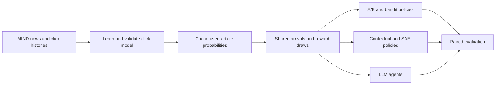
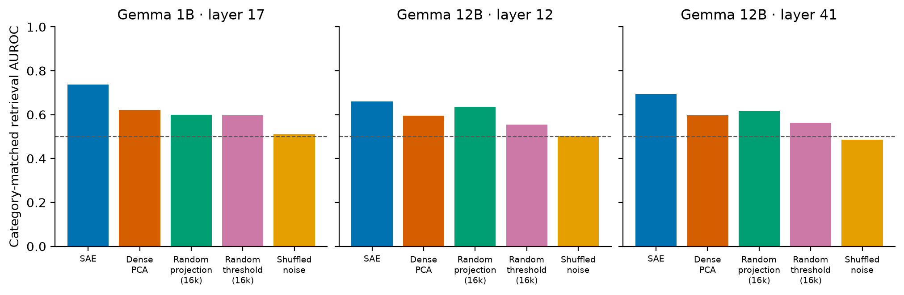
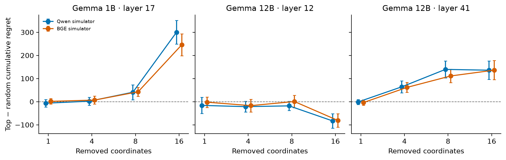
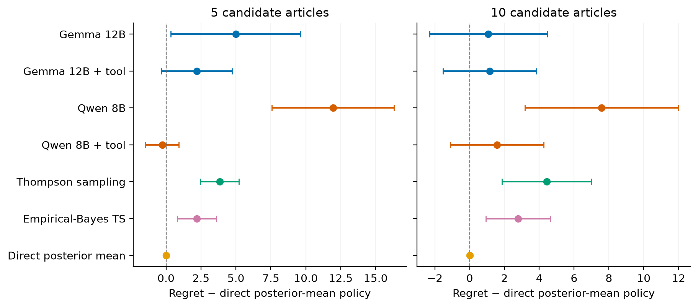
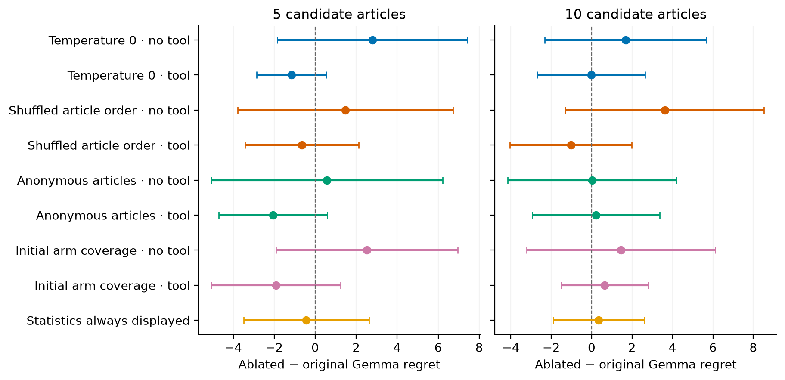
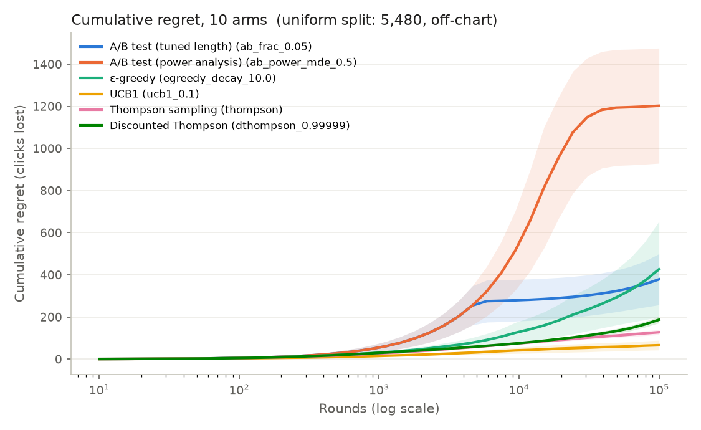
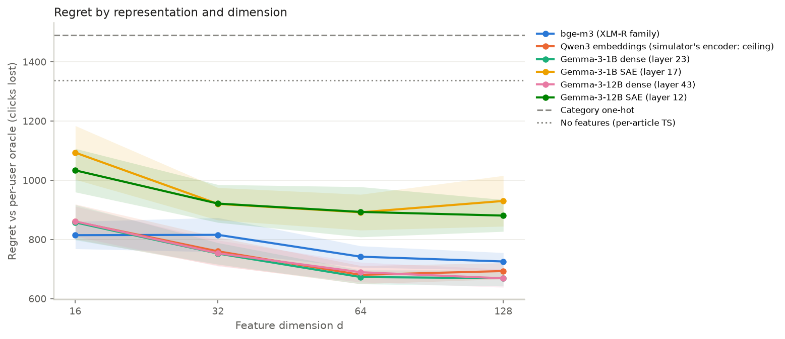

# Bandits vs. A/B Testing for News Recommendation

**Mansi Sethi · Samee Arif · Andrew Koss**

University of Michigan · CSE 592

When should a news recommender stop exploring, and what information helps it learn faster? We compare fixed A/B allocation, conventional bandits, contextual policies, sparse autoencoder (SAE) features, and LLM agents using a click simulator learned from MIND-large.

**All policy results are semi-synthetic.** Real news, reading histories, and logged clicks train and validate the simulator. Its estimated probabilities then generate bandit rewards and define the evaluation oracle. These experiments measure behavior within that simulator; they are not an online deployment or a counterfactual evaluation of MSN traffic.

[Results](#results) · [Setup](#setup) · [Replot results](#replot-results) · [Full experiment pipeline](#full-experiment-pipeline) · [Repository layout](#repository-layout) · [Limitations](#interpretation-and-limitations)

## Research questions

| Question | Comparison | Main measurements |
|---|---|---|
| **Q1: Allocation** | Explore-then-commit A/B, ε-greedy, UCB, Thompson sampling (TS), discounted TS | Cumulative regret, expected CTR, best-arm selection; stationary and drifting rewards |
| **Q2: Transfer to new articles** | No features, categories, BGE-M3, dense Gemma representations, SAE features | Personalized regret, cold-start regret, dimension and article-lifetime sensitivity |
| **Q3: Policy interpretation** | Train-ranked SAE features, post-hoc removal, retraining with features removed, random controls | Decision changes, regret changes, importance stability, label coverage |
| **Q4: LLM decisions** | Gemma-3-12B-IT and Qwen3-8B, posterior-statistics tools, headline priors, direct estimators | Regret, exploration failures, tool use, token consumption |



## Results

The November 21 validation campaign separates a clean temporal response model from the original frozen probability banks. [The model map](experiments/final_validation_20261121/response_model_map.json) identifies the teacher used by every experiment. All policy results remain **semi-synthetic**, conditional on these fitted response models.

The evaluation day is MIND's labeled November 15 development split, which was inspected in earlier work. This is **retrospective validation**, not an untouched confirmation set. The [protocol](experiments/final_validation_20261121/protocol.json) and [exploratory extensions](experiments/final_validation_20261121/extensions.json) retain the full sensitivity grids and explain follow-up choices.

Unless specified otherwise, ± denotes a 95% Student-t interval half-width across **30 paired article/user pools**. Random-feature seeds are averaged within pools; they do not increase the sample size to 90. The matched-feature, feature-removal, and matched-agent contrast tables retain Holm-adjusted p-values across their complete specified comparison families. Confidence intervals are pointwise. Semantic retrieval scores below are descriptive averages over dependent coordinates, not independent-feature confidence intervals.

### Response-model validation

Weights fit November 9–12; model/epoch selection uses November 13; refitting uses November 9–13; calibration uses November 14; evaluation uses November 15. The primary family and intercept calibrator were locked before the follow-up policy comparisons.

| Primary temporal MLP | Value |
|---|---:|
| Global / within-impression AUC | 0.7047 / 0.6645 |
| Log loss / Brier score | 0.16089 / 0.03825 |
| Equal-mass ECE | 0.00751 |
| Strictly excluded evaluation article IDs | 2,244 |

Two fixed-configuration initialization refits reach AUC 0.7042 and 0.7059. An otherwise matched BGE-M3 response model reaches 0.7069. All three model families, calibrators, strict-ID metrics, and initialization results are retained; these are model sensitivities, not independent real-user datasets.

[Complete model table](results/final_validation_20261121/tables/temporal_simulator.csv) · [Model results](results/final_validation_20261121/temporal_simulator/summary.json)

### Allocation and delayed feedback

At K=10 and T=10,000, frozen UCB changes from outperforming TS at immediate feedback to worse mean regret at batch size 1,000. The UCB-minus-TS differences are −31 ± 11 and +22 ± 15 clicks. After independent **training-only** retuning for each batch, the batch-1,000 difference is −12 ± 13 and is inconclusive. The observed reversal therefore depends on the tuning protocol.

The allocation suite also includes reward-aware test sizing, the two-arm normal Test-and-Roll approximation, KL-UCB, elimination, drift, terminal recommendation quality, and clean response-model family checks. It evaluates allocation reward; it does not establish the validity of an adaptive significance test.

[All allocation conditions](results/final_validation_20261121/tables/q1_allocation.csv) · [Batch retuning](results/final_validation_20261121/q1_batch_retune/summary.json)

### Feature quality, semantic alignment, and online utility

This comparison uses matched Gemma layers, D=32, separately train-selected LinUCB coefficients, 20 live articles, and 20,000 decisions. The random dictionaries contain 16,384 candidates and retain the 128 highest-variance training coordinates. The first D coordinates are used by the policy. Three direction seeds are retained for policy comparisons; the semantic comparison uses the predeclared seed 11.

| Matched layer | SAE − dense PCA regret | SAE − wide random projection regret | Semantic AUROC: SAE / PCA / wide random |
|---|---:|---:|---:|
| Gemma 1B, L17 | +40 ± 36 | -88 ± 27 | 0.738 / 0.621 / 0.600 |
| Gemma 12B, L12 | +92 ± 31 | -57 ± 24 | 0.659 / 0.595 / 0.635 |
| Gemma 12B, L41 | +129 ± 32 | -26 ± 29 | 0.695 / 0.598 / 0.618 |

Positive regret differences favor the control. Dense PCA has lower regret at both 12B layers on the main and strictly unseen article streams. The 1B dense/SAE contrast is inconclusive after the complete multiplicity adjustment. Widening the random dictionary substantially narrows the SAE advantage; at L41 the D=32 comparison is inconclusive. The full D=16/32/64, common-coefficient, small/wide-dictionary, neuron, threshold, and strict-ID comparisons are retained.

The automated semantic experiment captions **all 672 prespecified coordinates** with one blinded Gemma model using earlier headlines only. BGE-M3 scores retrieval on 2,244 excluded article IDs with category-matched negatives. All 32 coordinates per condition have adequate support in this run. Shuffled-feature scores are near chance (0.486–0.513), despite the captioner producing labels for every shuffled coordinate. Higher semantic retrieval does not establish human semantic correctness or better recommendation performance. No human annotations are used.

Thresholded random directions operate at the **article level** and match source activation-frequency targets. They are not token-level random SAEs. Width and selection controls narrow the comparison but do not isolate learned SAE training as the only difference.

[All feature contrasts](results/final_validation_20261121/tables/q2_matched_contrasts.csv) · [Feature geometry](results/final_validation_20261121/tables/feature_geometry.csv) · [Semantic results](results/final_validation_20261121/semantic_comparison/summary.json)



### Feature interventions reconstructed from the policy state

The runner now copies CPU context snapshots and optionally records pre-action weights, inverse covariance, and choices. Full UCB scores reconstruct the recorded choices with zero maximum score gap in all three tested layers.

Removing train-ranked top-four coordinates at the later 12B layer produces **64 ± 26** more regret than equal-sized random removal under the Qwen response model and **62 ± 21** under BGE. At the earlier 12B layer, top-16 removal instead improves regret relative to random removal (−83 ± 31 and −81 ± 29). These effects survive the adjustment across all 24 removal contrasts. Single-coordinate removal at L41 remains inconclusive. Decision sensitivity, retraining necessity, subset sufficiency, and semantic clarity answer different questions.

The transfer check freezes ranks, masks, and exploration settings before changing the response model. This is an algorithmic intervention within two learned simulators, not a causal statement about real readers. The separate correlation experiment uses one-hop training-correlation neighborhoods, plus retain-only subsets.

The original saved-context bug is corrected in the historical Q3 snapshot too. Its earlier 111 ± 51 top-eight claim is withdrawn; the corrected original setup gives 35 ± 45. The newer full-state study uses a different, explicitly documented protocol.

[All removal contrasts](results/final_validation_20261121/tables/q3_necessity_contrasts.csv) · [Full-state results](results/final_validation_20261121/q3_interventions/summary.json) · [Teacher transfer](results/final_validation_20261121/q3_teacher_transfer/summary.json)



### Agent comparisons

All **26 configurations** are complete: 30 pools per cell, 500 rounds, and **390,000 audited agent decisions**. These runs use the **original frozen response bank**, not the clean temporal refit.

| Policy | K=5 regret | K=10 regret |
|---|---:|---:|
| Gemma 12B, no tool | 10.27 ± 4.87 | 11.49 ± 3.68 |
| Gemma 12B, optional tool | 7.47 ± 2.18 | 11.57 ± 3.07 |
| Qwen 8B, no tool | 17.22 ± 4.40 | 17.99 ± 4.25 |
| Qwen 8B, optional tool | 5.01 ± 0.89 | 11.98 ± 2.88 |
| Gemma 12B, statistics always displayed | 7.04 ± 2.06 | 11.92 ± 2.19 |
| Direct posterior mean | 5.28 ± 1.02 | 10.42 ± 2.04 |
| Thompson sampling | 9.12 ± 1.45 | 14.84 ± 2.59 |
| Empirical-Bayes Thompson sampling | 7.48 ± 1.29 | 13.19 ± 1.98 |

The optional tool lowers Qwen regret by **12.21 ± 4.52** at K=5 and **6.02 ± 3.74** at K=10. Holm-adjusted p-values within the complete 12-contrast tool family are 0.000070 and 0.0286. Gemma’s original tool/no-tool contrasts remain inconclusive. Qwen with the tool beats conventional Thompson sampling at K=5, but its difference from direct posterior-mean choice is **−0.26 ± 1.19**. No tested agent configuration has a resolved advantage over direct posterior-mean choice in the complete 208-contrast numerical-baseline family.

All **18 ablation-versus-original** intervals span zero: temperature zero, shuffled article order, anonymized headlines, initial arm coverage, and always-displayed statistics. These outcomes do not establish equivalence. The separate tool/no-tool contrast within Gemma’s K=5 initial-coverage condition is −7.24 ± 4.71 (Holm p=0.0382); that result does not establish that initial coverage improves the original agent.

The numerical suite retains posterior means, upper bounds, probability-of-best choice, Thompson sampling, flat training-CTR priors at strengths 10/100/1,000, and empirical-Bayes priors. Flat priors use the observed training CTR (0.040519); empirical Bayes fits moments to **training simulator article-rate samples** (mean 0.027746). Historical headline-ranked/shuffled-prior experiments are retained separately; they use earlier rankings rather than the fresh agent probes.

There are **31 parsing failures in 390,000 decisions (0.008%)**. Each keeps the documented uniform-random fallback; no failed responses or pools are removed.

[All matched conditions](results/final_validation_20261121/tables/q4_matched_conditions.csv) · [All 242 paired contrasts](results/final_validation_20261121/tables/q4_matched_contrasts.csv) · [Locked analysis families](results/final_validation_20261121/q4_analysis_plan.json) · [Integrity audit](results/final_validation_20261121/validation_audit.json)





## Setup

Use Python 3.11 and run commands from the repository root. The core environment trains and evaluates simulators and policies; the separate vLLM environment serves the agents and captioner. Their recorded PyTorch versions differ, so keep them separate.

```bash
GIT_LFS_SKIP_SMUDGE=1 git clone https://github.com/manassethi/mind-bandits.git
cd mind-bandits
git lfs install
python3 -m venv .venv
.venv/bin/python -m pip install -r requirements.txt

python3 -m venv .venv-vllm
.venv-vllm/bin/python -m pip install vllm==0.32.0 scipy pandas pyarrow
```

The [environment snapshot](experiments/final_validation_20261121/software_environments.json) records the installed campaign versions. CUDA inference requires a compatible driver and sufficient GPU memory. Authenticate with `hf auth login` for gated models and accept their applicable terms using your own account. Credentials belong in the environment or credential store; `.env` files are ignored by Git.

Gemma agents and the captioner use checkpoint `96b6f1eccf38110c56df3a15bffe176da04bfd80`; Qwen uses `b968826d9c46dd6066d109eabc6255188de91218`. The worker uses a fresh-process launch to avoid a Torch startup deadlock observed with `fork`.

## Replot results

The compact export contains per-pool summary vectors, tables, and scientific figures. Replotting needs no model inference or raw all-layer features:

```bash
# Recompute all matched-agent contrasts from the compact per-pool vectors.
.venv/bin/python -m scripts.final_validation.q4_comparisons
# Regenerate every scientific diagnostic figure.
.venv/bin/python -m scripts.final_validation.figures
```

Full integrity checking additionally needs the saved run arrays and probability environments:

```bash
.venv/bin/python -m scripts.final_validation.analyze --strict
```

The strict checker verifies stored per-pool results, exact paired agent rewards, source-model revisions, probability bounds, strict-ID exclusions, context reconstruction, and semantic coverage. It must not be treated as a novelty assessment or a substitute for interpreting the full results. A summary-only checkout cannot pass the raw-array checks. [Artifact hashes](results/final_validation_20261121/artifact_manifest.json) identify the compact export.

## Full experiment pipeline

Use a GPU allocation for CUDA commands. The commands below run sequentially and preserve the published snapshot by writing to a **fresh output directory**. Every shell used for a stage must have the same `FINAL_OUT` value. Several runners refuse to reuse results with changed inputs or source hashes.

The historical probability banks, processed impressions, selected policy features, and external labels are inputs to the follow-up study:

```bash
git lfs pull --include="dataset/processed/**,models/**,results/q1/**,results/q2/**,results/q3/**,results/q4/**"
export FINAL_OUT=results/reproduction_20261121
```

The complete matched-layer/random-dictionary rebuild also requires the uncommitted `dataset/processed/policy_raw/` cache. Regenerate it with the extraction/reduction commands in the historical input section below. The compact summaries are sufficient for replotting, but do not replace that cache for new experiments.

### 1. Validate the probability interface and fit response models

```bash
# Known-response probability, zero-gap, oracle, and policy sanity checks.
.venv/bin/python -m scripts.final_validation.synthetic_checks --workers 6
# Disjoint selection/calibration days; all model families and calibrators retained.
.venv/bin/python -m scripts.final_validation.temporal_simulator --device cuda
# Fit reductions/random controls on earlier article rows only.
.venv/bin/python -m scripts.final_validation.q2_controls prepare
# Cache matched main/strict streams, model families, and response-difficulty transforms.
.venv/bin/python -m scripts.final_validation.q2_controls envs --device cuda
```

### 2. Compare allocation and feature policies

```bash
# Six arm/horizon/drift conditions, each with feedback batches 1/100/1000.
for condition in 0 1 2 3 4 5; do
  .venv/bin/python -m scripts.final_validation.q1_allocation --index "$condition"
done
.venv/bin/python -m scripts.final_validation.q1_batch_retune --workers 3
.venv/bin/python -m scripts.final_validation.q1_simulator_family --workers 6
# Train-select feature-policy coefficients, then evaluate every retained control.
.venv/bin/python -m scripts.final_validation.q2_controls experiments --workers 8
# Width/selection-matched dictionaries; evaluate main and strict article streams.
.venv/bin/python -m scripts.final_validation.q2_wide_controls prepare --device cuda
.venv/bin/python -m scripts.final_validation.q2_wide_controls evaluate --workers 8
```

### 3. Check simulator sensitivity and feature interventions

```bash
.venv/bin/python -m scripts.final_validation.simulator_seeds fit --device cuda
.venv/bin/python -m scripts.final_validation.simulator_seeds evaluate --workers 8
.venv/bin/python -m scripts.final_validation.alternate_encoder fit --device cuda
.venv/bin/python -m scripts.final_validation.alternate_encoder evaluate --workers 8
# Reconstruct the complete pre-action UCB rule; remove top/bottom/random coordinates.
.venv/bin/python -m scripts.final_validation.q3_interventions --workers 8
# One-hop correlation neighborhoods and retain-only subsets.
.venv/bin/python -m scripts.final_validation.q3_redundancy --workers 8
# Same masks/ranks/settings, now under the BGE response model.
.venv/bin/python -m scripts.final_validation.q3_teacher_transfer --workers 8
```

To reproduce the corrected original Q3 setup separately, give its runner the stored legacy environments and labels:

```bash
mkdir -p "$FINAL_OUT/q3_recheck"
ln -s "$(pwd)/results/q3/envs" "$FINAL_OUT/q3_recheck/envs"
ln -s "$(pwd)/results/q3/labels" "$FINAL_OUT/q3_recheck/labels"
Q3_OUT="$FINAL_OUT/q3_recheck" .venv/bin/python -m scripts.run_q3 --workers 8
Q3_OUT="$FINAL_OUT/q3_recheck" .venv/bin/python -m scripts.analyze_q3
```

### 4. Run automated semantic validation

```bash
# External Neuronpedia labels, category-matched negatives, and 1,000 label permutations.
.venv/bin/python -m scripts.final_validation.semantic_checks
# Build blinded high/low headline prompts from earlier articles only.
.venv/bin/python -m scripts.final_validation.semantic_comparison prepare
# Generate all 672 captions with the same frozen model.
.venv-vllm/bin/python -m scripts.final_validation.semantic_comparison generate
# Verify embedding-space alignment and score strict-held-out retrieval.
.venv/bin/python -m scripts.final_validation.semantic_comparison evaluate
```

### 5. Isolate agent, tool, and prior contributions

```bash
# Direct posterior statistics, ranked/shuffled priors, and exact displayed-tool audit.
.venv/bin/python -m scripts.final_validation.q4_statistics
.venv/bin/python -m scripts.final_validation.q4_tool_audit
.venv/bin/python -m scripts.final_validation.q4_prior_controls
.venv/bin/python -m scripts.final_validation.benchmark_statistics
# Fresh matched baselines, including the second model family (thinking disabled).
.venv-vllm/bin/python -m scripts.final_validation.q4_ablation --index 5
.venv-vllm/bin/python -m scripts.final_validation.q4_ablation --index 5 --model Qwen/Qwen3-8B
# Temperature 0, title-order shuffle, anonymous articles, round-robin warmup, always-supplied statistics.
for condition in 0 1 2 3 4; do
  .venv-vllm/bin/python -m scripts.final_validation.q4_ablation --index "$condition"
done
```

The always-displayed condition puts the statistics in the existing user turn, as required by Gemma’s alternating-role template. [The source change record](experiments/final_validation_20261121/source_changes.json) preserves the exact earlier source used by completed conditions. In this condition, the saved `tool_called` flag means statistics were supplied; the model makes no separate tool request.

All real agent runs use 30 pools and 500 decisions by default. Agent counts, choices, rewards, and tool RNG are checkpointed every 25 rounds. A process restart resets vLLM generation RNG; summaries disclose resumes. Runtime excludes model loading and is an amortized batched measurement, not single-request latency or monetary cost.

### 6. Audit and export

```bash
.venv/bin/python -m scripts.final_validation.analyze --strict
.venv/bin/python -m scripts.final_validation.figures
.venv/bin/python -m unittest discover -s tests -p test_context_snapshots.py
```

<details>
<summary>Historical input preparation, original results, and original sweeps</summary>

## Historical snapshot

The tables below summarize the historical simulator snapshot. Q3 was corrected and rerun after a saved-context bug was found on November 21, 2026. The completed validation study above supersedes broader interpretations from this historical snapshot; comparisons remain specific to their response bank. Values after **±** are 95% t-interval half-widths over **30 evaluation runs**. Regret is measured in expected clicks lost; lower is better. Comparisons between policies use paired runs. The oracle and horizon differ across questions, so regret values should be compared **within** an experiment.

### Simulator validation

Model selection fits November 9–13, 2019 and validates on November 14. The selected two-epoch MLP is refit on November 9–14 and evaluated on November 15. Article title and abstract embeddings come from [Qwen3-Embedding-0.6B](https://huggingface.co/Qwen/Qwen3-Embedding-0.6B); user features summarize previously clicked articles.

| Quantity | Value |
|---|---:|
| Article catalog, union of the two labeled splits | 104,151 |
| Training impressions / candidate pairs | 2,232,748 / 83,507,374 |
| Evaluation impressions / candidate pairs | 376,471 / 14,085,557 |
| Training / evaluation click rate | 4.052% / 4.081% |
| Evaluation global AUC | 0.7329 |
| Evaluation mean per-impression AUC | 0.6862 |
| Anchored evaluation log loss / Brier score | 0.15837 / 0.03843 |
| Anchored ECE, 15 equal-mass bins | 0.00892 |
| Anchored mean predicted click rate | 4.052% |

The anchor adjusts the logit intercept to match the training CTR over evaluation-day covariates, without using evaluation labels. This is a **transductive** calibration step. It preserves ranking metrics, slightly improves log loss and ECE, and slightly worsens Brier score. See [model selection](results/click_model/selection.json), [uncalibrated metrics](results/click_model/metrics.json), and [calibration diagnostics](results/click_model/calibration.json).

### Q1: A/B testing versus bandits

Ten articles, 100,000 decisions, 2,000 sampled users per run. Hyperparameters, including A/B exploration length, are chosen on training-day pools separately for each condition. The non-contextual oracle selects the article with the highest population mean probability at each time.

| Policy | Stationary regret | Abrupt-drift regret | Gradual-drift regret |
|---|---:|---:|---:|
| A/B, tuned explore-then-commit | 379 ± 121 | 3,410 ± 1,404 | 1,601 ± 397 |
| ε-greedy, tuned | 426 ± 227 | 2,995 ± 1,370 | 1,177 ± 424 |
| UCB, tuned exploration coefficient | **66 ± 23** | **629 ± 202** | 649 ± 270 |
| Thompson sampling | 128 ± 12 | 1,360 ± 367 | 642 ± 192 |
| Discounted Thompson sampling, tuned | 187 ± 15 | 770 ± 59 | **444 ± 67** |

UCB has the lowest mean regret in the stationary and abrupt conditions shown; discounted TS has the lowest mean under gradual drift. Short horizons are less decisive: at 1,000 decisions, the paired A/B-minus-TS difference is **1 ± 12** clicks. Full results also cover 2, 5, 20, and 50 articles and power-analysis A/B allocation.

[Full Q1 tables](results/q1/summary.md) · [Machine-readable results](results/q1/summary.json) · [Selected settings](results/q1/tuned.json)



### Q2: Contextual policies under article churn

Twenty articles are live at once, each lives for 2,000 rounds, and one replacement arrives every 100 rounds. Each run has 20,000 decisions and 2,000 sampled users. Features have 32 dimensions, except the 18-category baseline. Policies and representation layers are chosen on training-day pools. The oracle selects the best live article **for the arriving user**.

| Representation | Selected policy | Regret | Expected CTR |
|---|---|---:|---:|
| No features | Per-article TS | 1,338 ± 28 | 5.77% |
| Category one-hot | LinUCB | 1,490 ± 100 | 5.01% |
| BGE-M3 | LinUCB | 816 ± 58 | 8.38% |
| Gemma-3-1B dense, layer 23 | LinUCB | **753 ± 36** | 8.69% |
| Gemma-3-1B SAE, layer 17 | LinUCB | 920 ± 55 | 7.86% |
| Gemma-3-12B dense, layer 43 | LinUCB | 754 ± 44 | 8.69% |
| Gemma-3-12B SAE, layer 12 | Linear TS | 921 ± 64 | 7.85% |

Dense content representations improve on per-article TS in this environment. The SAE-minus-dense paired regret differences are **168 ± 55** clicks for 1B and **168 ± 67** for 12B. These comparisons use separately selected layers and policy settings; they do not isolate sparsity as the only cause. The full analysis includes dimensions 16–128, all dense layers, and article lifetimes 500–10,000 rounds. Qwen-based policy features are a simulator-sharing diagnostic, rather than an independent encoder comparison.

[Full Q2 tables](results/q2/summary.md) · [Machine-readable results](results/q2/summary.json) · [Layer choices](results/q2/chosen_layers.json)



### Q3: What do SAE features explain?

A CPU snapshot bug made recorded article pools alias a tensor that changed during the run. The implementation now copies each context, and the Q3 importance rankings and ablations have been rerun. The earlier **111 ± 51** top-eight-minus-random regret claim is withdrawn.

Under the corrected original setup, the exploratory Gemma-3-12B layer-41 policy has train-versus-test importance correlation **0.89**. The corrected top-four-minus-random retraining difference is **58 ± 30** expected clicks. The top-eight difference is **35 ± 45** and remains inconclusive. Effects vary with removal size and layer; the complete corrected grid is retained below.

These historical post-hoc diagnostics rescore the final policy's mean predictions on recorded contexts. Their random-control intervals vary over 50 feature-mask draws; retraining intervals use 30 paired pools. They do not reconstruct the complete pre-action UCB rule. Full-state interventions and matched representation controls are being evaluated separately. Semantic validation uses automated held-out headline retrieval and shuffled-label controls; no human annotations are claimed.

[Corrected Q3 tables and layer replications](results/q3/summary.md) · [Corrected results JSON](results/q3/results.json) · [Feature weights](results/q3/g12b_sae_L41/weights.csv) · [Feature examples](results/q3/g12b_sae_L41/handcheck.csv)

### Q4: LLM agents with a statistics tool

Ten headline arms, 500 decisions, 30 pools. Arm probabilities average simulator predictions over 20,000 sampled users. Gemma-3-12B-IT receives article titles and accumulated shows/clicks; the tool adds Beta-posterior means, upper quantiles, and estimated probabilities of being best. Generation uses temperature 1.0 and at most 160 output tokens per call.

| Policy | Regret | Stuck runs | Tokens per 1,000 decisions |
|---|---:|---:|---:|
| LLM | 15.2 ± 4.2 | 70% | 551,389 |
| LLM + statistics tool | **9.3 ± 2.6** | 3% | 932,264 |
| Thompson sampling | 14.7 ± 2.6 | 0% | — |
| UCB, coefficient 0.1 | 9.9 ± 1.5 | 3% | — |
| ε-greedy, ε = 0.1 | 10.2 ± 3.3 | 20% | — |

“Stuck” means at least 90% of second-half choices go to one suboptimal arm. The tool-assisted LLM improves over TS by **5.4 ± 2.8** clicks in paired runs, while requiring more tokens than the unaided LLM. The intervals do not establish an advantage over tuned UCB. Token counts include prompts and completions; they are not monetary costs or per-decision latency measurements.

[Full Q4 tables, including five-arm runs](results/q4/summary.md) · [Machine-readable results](results/q4/summary.json) · [Logged-CTR validation](results/q4/prior_validation.md) · [Headline-prior probe](results/q4/prior_probe.md)


## Historical input preparation and sweeps

Run stages 1–3 before any experiment that needs fresh simulator probabilities. Q1, Q2, and Q4 can then proceed independently; Q3 depends on Q2 features, tuned settings, and evaluation environments. Commands below use CUDA where supported. Replace `--device cuda` with `--device cpu` or `--device mps` for simulator inference on other hardware; CPU runs of the full pipeline can be slow. Q2 policy workers automatically use available CUDA devices, otherwise CPU; their `--device` option controls environment construction.

### 1. Prepare MIND-large

Download the **large training and validation** archives from the [official MIND site](https://msnews.github.io/) under its dataset terms. The code names the labeled validation directory **`test`**. It is the November 15 development split, **not the hidden-label official test set**.

```bash
mkdir -p dataset/raw/mind-large/train dataset/raw/mind-large/test
unzip /path/to/MINDlarge_train.zip -d dataset/raw/mind-large/train
unzip /path/to/MINDlarge_dev.zip -d dataset/raw/mind-large/test
python -m scripts.prepare_mind
```

The input folders must contain `news.tsv` and `behaviors.tsv`. Preparation builds a shared article index, `dataset/processed/news.parquet`, and compact training/evaluation impression arrays. Candidate labels and clicked histories remain separate.

### 2. Encode articles and fit the simulator

```bash
python -m scripts.embed_articles --device cuda --batch-size 64
python -m scripts.train_click_model --device cuda
```

The first command embeds titles and abstracts into `dataset/processed/sim_qwen3_embeddings.npy`. The second compares logistic, bilinear, and MLP models, selects the model and epoch count on November 14, refits on the full training split, and evaluates on November 15. It writes `models/click_model.pt`, `results/click_model/{selection,metrics}.json`, evaluation probabilities, and cached evaluation-user features.

### 3. Apply the CTR anchor once

```bash
python -m scripts.calibrate_click_model --method anchor --device cuda
```

This updates the checkpoint and `results/click_model/test_probs.npy`, and writes `calibration.json`. Run it **once after a fresh fit and before creating experiment environments**. The script refuses an already calibrated checkpoint. The published checkpoint is already anchored; skip stages 1–3 if using it with the matching processed artifacts:

```bash
# Alternative to rebuilding the stored simulator and processed inputs.
git lfs pull --include="models/**,dataset/processed/**,results/click_model/**"
```

This artifact download includes the **selected** policy representations, not the full all-layer raw feature cache. Stages 4 and 7 can use the stored simulator directly; the complete Q2 layer sweep needs stage 5.

### 4. Q1 — fixed allocation and conventional bandits

```bash
python -m scripts.run_q1 --split train --workers 8 --device cuda
python -m scripts.run_q1 --split test --workers 8 --device cuda
python -m scripts.analyze_q1
```

Training uses 20 pools and evaluation uses 30. The runner caches probabilities under `results/q1/envs/`, then evaluates the policy grid on CPU workers with matched user arrivals and reward uniforms. It covers article counts 2/5/10/20/50, horizons 1,000/10,000/100,000, and abrupt/gradual drift. Outputs are `results/q1/{train,test}/*.npz`, selected settings, summaries, a CSV of all variants, and plots. Use `--conditions K10` to restrict policy evaluation to a condition; environment preparation may still populate other missing caches.

### 5. Q2 — policy representations and contextual experiments

```bash
# Extract the independent policy encoders and SAE activations.
python -m scripts.extract_policy_features --model bge-m3 --device cuda
python -m scripts.extract_policy_features --model gemma-3-1b --device cuda --max-tokens 16384
python -m scripts.extract_policy_features --model gemma-3-12b --device cuda --max-tokens 16384

# Fit reductions on training articles and apply them to the catalog.
python -m scripts.build_policy_features

# Run these experiment stages in order.
python -m scripts.run_q2 --stage envs --device cuda
python -m scripts.run_q2 --stage tune --workers 1
python -m scripts.run_q2 --stage layers --workers 1
python -m scripts.run_q2 --stage test --workers 1
python -m scripts.run_q2 --stage churn --workers 1
python -m scripts.analyze_q2
```

| Stage | Purpose | Main output |
|---|---|---|
| Extraction | Mean-pool every Gemma decoder layer and selected Gemma Scope 2 SAE layers; encode BGE-M3 articles | `dataset/processed/policy_raw/<model>/` |
| Reduction | Standardize and PCA-reduce dense features; select and RMS-scale 128 SAE coordinates using training articles | `dataset/processed/policy_features/*.npy`, `meta.json` |
| `envs` | Cache 20-live-article environments for training and evaluation | `results/q2/envs/*.npz` |
| `tune` | Choose LinUCB and linear-TS exploration settings on training runs | `results/q2/tune/`, `tuned.json` |
| `layers` | Evaluate layers; select dense and SAE layers using training performance | `results/q2/layers/`, `chosen_layers.json` |
| `test` | Compare selected representations at dimensions 16/32/64/128 | `results/q2/test/` |
| `churn` | Repeat with article lifetimes 500 and 10,000 rounds | `results/q2/churn/` |

Training has 10 runs and evaluation has 30. On clusters with exclusive GPU access, use at most one worker per visible GPU; increase `--workers` only when the allocation supports it. SAE extraction uses the `width_16k_l0_medium` residual-stream checkpoints from [Gemma Scope 2](https://huggingface.co/google/gemma-scope-2-12b-pt), with a custom JumpReLU encoder. All-layer raw features are large and are regenerated rather than distributed in this repository. The stored reduced features cover selected comparisons and Q3 representations, rather than every layer or tuning representation.

For a smaller pipeline check, set `Q2_SMOKE=1` and a **separate** output directory, for example `Q2_OUT=results/q2_smoke`. Apply both environment variables to every Q2 stage and its analysis. Smoke mode uses 3/4 training/evaluation runs and 2,000 rounds, and still requires the feature files. It does not reproduce the main results.

### 6. Q3 — SAE importance and controlled removal

Complete Q2 through layer selection first. Q3 also needs a separate 30-run training environment for importance ranking. Retrieve the stored environment with `git lfs pull --include="results/q3/envs/**"`, or generate it with the original seed:

```bash
python - <<'PY'
from pathlib import Path
import numpy as np
from src.bandits.contextual import ChurnSchedule, build_churn_env
from src.simulator.simulator import ClickSimulator

out = Path("results/q3/envs/train30_life2000.npz")
out.parent.mkdir(parents=True, exist_ok=True)
if not out.exists():
    sim = ClickSimulator.load(split="train", device="cuda")
    env = build_churn_env(sim, 30, 2000, ChurnSchedule(20, 2000, 20000), seed=5002000)
    np.savez(out, **env)
PY

# Skip fetching if using the committed label snapshot.
python -m scripts.fetch_neuronpedia_labels g12b_sae_L41 g12b_sae_L31 g1b_sae_L17
python -m scripts.run_q3 --workers 8
python -m scripts.analyze_q3
```

`run_q3` ranks features on training-day runs, evaluates importance stability and weights on evaluation-day runs, and compares top-feature removal with random controls. Post-hoc tests use 50 random feature sets; retraining uses five. Outputs include `results/q3/results.json`, per-layer weights and feature-example CSVs, summaries, and ablation plots. Neuronpedia labels are an external snapshot; fetching them again may change labels and coverage.

### 7. Q4 — LLM policies and headline priors

Build the fixed environments with the core environment active:

```bash
python -m scripts.build_q4_envs --device cuda

# Optional engine check: deterministic mock responses, no model download.
python -m scripts.run_q4_llm --mock --runs 2 --horizon 20
```

The builder saves real headline pools, population probabilities, and common reward uniforms in `results/q4/envs.{npz,json}`. The mock writes `llm_mock*` files, which the analysis excludes. It checks the agent loop; it is not a synthetic replacement for the learned click simulator.

Use a separate CUDA environment for [vLLM](https://docs.vllm.ai/en/latest/getting_started/installation/). Install a vLLM/PyTorch combination compatible with the GPU driver before running the real agent:

```bash
python3 -m venv .venv-vllm
source .venv-vllm/bin/activate
python -m pip install vllm numpy scipy pandas pyarrow scikit-learn matplotlib

python -m scripts.run_q4_llm --model google/gemma-3-12b-it --temperature 1.0 --max-tokens 160 --tp 1

# Return to the core environment for analysis and simulator-based checks.
source .venv/bin/activate
python -m scripts.analyze_q4
python -m scripts.validate_q4_prior --device cuda

# Additional prior probe: 200 mixed-category and 200 same-category groups of five.
python -m scripts.prior_probe build --device cuda
source .venv-vllm/bin/activate
python -m scripts.prior_probe run --model google/gemma-3-12b-it
source .venv/bin/activate
python -m scripts.prior_probe analyze
```

The real agent evaluates both tool conditions for 5 and 10 arms, 30 pools, and 500 rounds. It writes decision arrays, generation settings, token counts, and sampled transcripts under `results/q4/llm_gemma-3-12b-it*`. `--tp` controls tensor parallelism. Simulator validation additionally requires `results/click_model/test_probs.npy`. The prior probe ranks articles with at least 100 logged candidate exposures; its logged CTR comparison is observational and subject to the logging policy.


</details>

## Simulator interface

The shared interface operates on **processed row indices**, not raw MIND article IDs:

```python
import numpy as np
from src.simulator.simulator import ClickSimulator

sim = ClickSimulator.load(split="test", device="cpu")
rng = np.random.default_rng(0)
users = sim.sample_users(8, rng)
articles = sim.sample_articles(5, rng)
p = sim.prob_matrix(users, articles)  # shape (8, 5), values in [0, 1]
```

A reward is sampled as `uniform < p[user, chosen_article]`. Policies observe the selected article's binary reward, while the evaluation code can access all probabilities to compute regret. Cached environments allow policy work without repeatedly loading the click model. `sample_users` defaults to users with at least one history article; it samples processed impression-history rows, rather than deduplicated people.

## Interpretation and limitations

- Response probabilities and evaluation oracles come from learned simulators. Predictive validation and sensitivity checks do not identify real counterfactual user responses.
- Main and strict-ID comparisons share the same evaluation day. Foundation-model pretraining is not an article-ID holdout; exclusions apply to this project's fitting stages.
- Semantic retrieval uses one captioner, one scoring encoder, and fixed coordinate/direction selections. Coordinates within a layer are dependent. The metric is an automated proxy, not human semantic ground truth.
- Feature interventions test the algorithm's use of its representation. They do not establish that manipulating the corresponding news concept would cause a reader to click.
- The primary and exploratory grids are retained in full. Absence of a resolved difference is not evidence of equivalence.
- The ablation grid uses Gemma; Qwen has the original tool/no-tool comparison only. Each condition uses one generation seed. Pool intervals do not estimate repeated-generation variability or identify model-internal mechanisms.
- Historical and clean-temporal banks use different fitting/calibration rules. Regret values are comparable within a bank, oracle, and horizon.

## Repository layout

```text
src/                    Simulator, data, agent, and bandit implementations
scripts/                Historical input preparation and baseline experiments
scripts/final_validation/
                        Controlled follow-up experiments, audits, figures
experiments/final_validation_20261121/
                        Protocol, exploratory choices, model map, environment metadata
results/final_validation_20261121/
                        Compact summaries, per-pool vectors, tables, figures
results/q1–q4/          Historical input banks and corrected original Q3 snapshot
models/                 Original fitted simulator (Git LFS)
dataset/processed/      Processed inputs and selected policy features (Git LFS)
tests/                  Context-snapshot regression check
```

Credentials, raw datasets, all-layer feature caches, scheduler files, logs, notes, and manuscript sources are excluded from the repository.

## Data and model references

- [MIND: A Large-scale Dataset for News Recommendation, Wu et al., ACL 2020](https://aclanthology.org/2020.acl-main.331/) — dataset and logged recommendation task.
- [Qwen3-Embedding-0.6B](https://huggingface.co/Qwen/Qwen3-Embedding-0.6B) — simulator article encoder.
- [BGE-M3](https://huggingface.co/BAAI/bge-m3) — independent sentence-embedding features.
- [Gemma-3-1B-PT](https://huggingface.co/google/gemma-3-1b-pt), [Gemma-3-12B-PT](https://huggingface.co/google/gemma-3-12b-pt), and [Gemma-3-12B-IT](https://huggingface.co/google/gemma-3-12b-it) — policy representations and LLM agent.
- [Gemma Scope 2, 1B](https://huggingface.co/google/gemma-scope-2-1b-pt) and [12B](https://huggingface.co/google/gemma-scope-2-12b-pt) — pretrained SAE checkpoints.
- [Neuronpedia](https://www.neuronpedia.org/) — external feature explanations.
- [Qwen3-8B](https://huggingface.co/Qwen/Qwen3-8B) — second agent family, with thinking disabled.

## Related methods

- [Test & Roll: Profit-Maximizing A/B Tests](https://arxiv.org/abs/1811.00457), Feit and Berman (2019) — reward-aware test sizing and the two-arm normal approximation.
- [Can large language models explore in-context?](https://arxiv.org/abs/2403.15371), Krishnamurthy et al. (2024) — summarized histories and exploration diagnostics for bandit agents.
- [Should You Use Your Large Language Model to Explore or Exploit?](https://arxiv.org/abs/2502.00225), Harris and Slivkins (2026) — separating exploration from exploitation and comparing tools with simple estimators.
- [Are Sparse Autoencoders Useful? A Case Study in Sparse Probing](https://arxiv.org/abs/2502.16681), Kantamneni et al. (2025) — evaluating downstream utility against strong non-SAE representations.
- [Sanity Checks for Sparse Autoencoders: Do SAEs Beat Random Baselines?](https://arxiv.org/abs/2602.14111), Korznikov et al. (2026) — controlling random feature directions and activation patterns. Our article-level controls have a different scope from their token-level baselines.

MIND and pretrained models retain their respective licenses and access terms.
